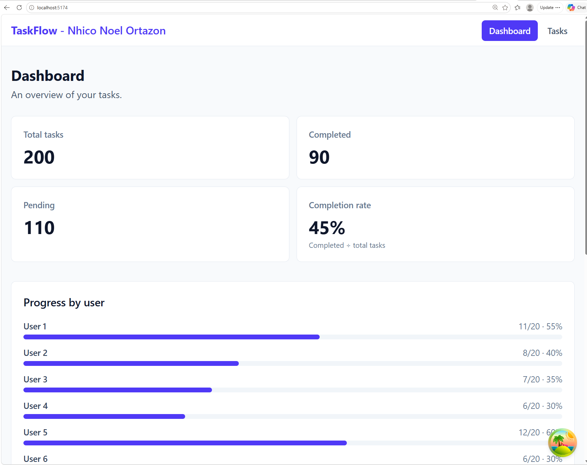
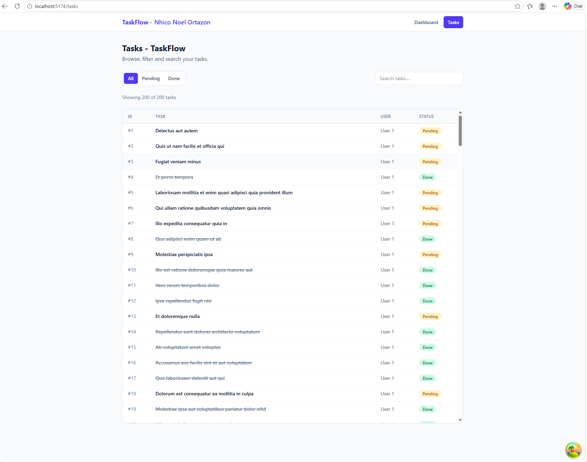
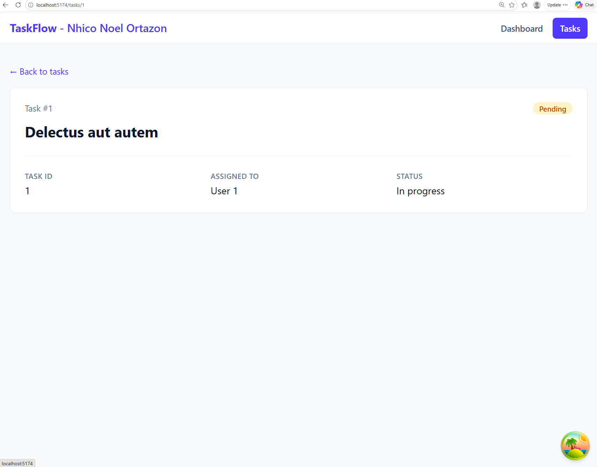
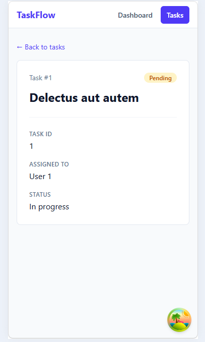
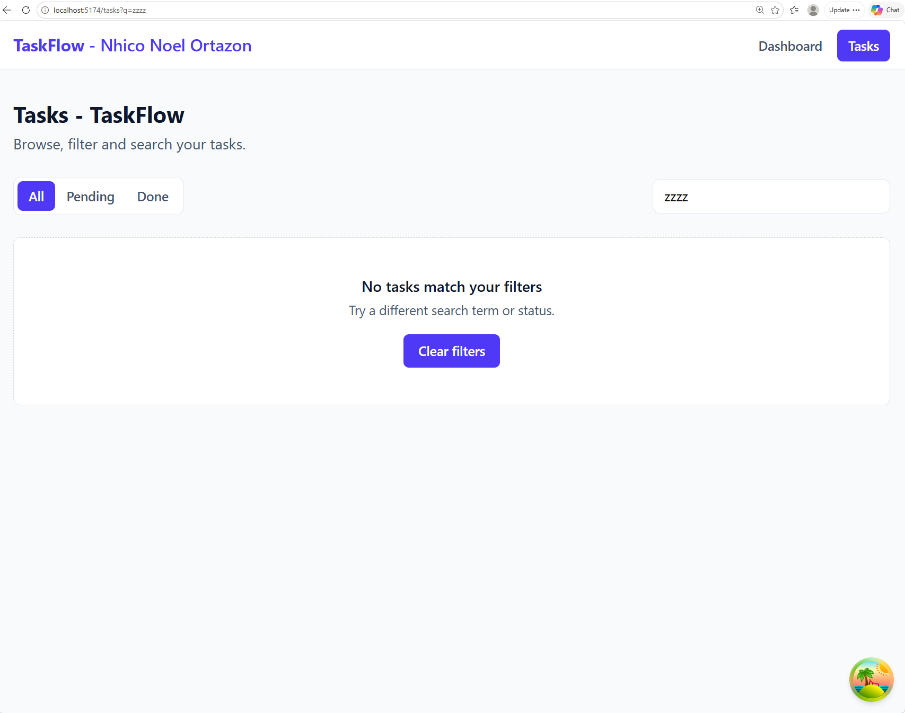
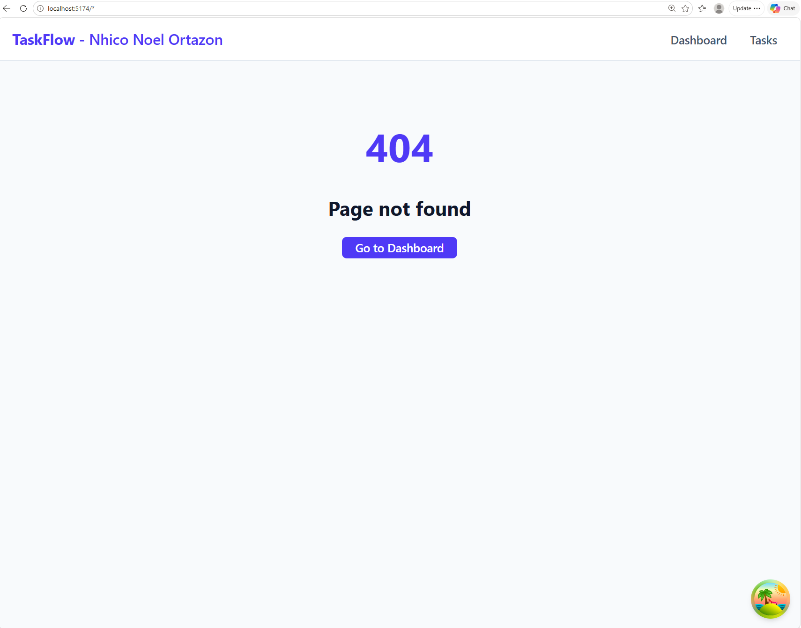
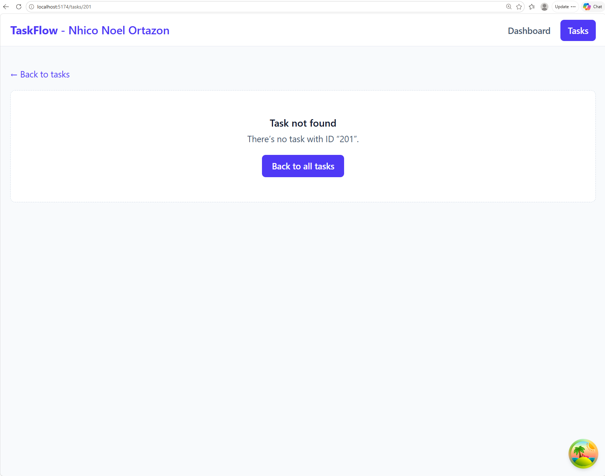

# TaskFlow — Nhico Noel Ortazon Mini Project at Asia 

# TaskFlow — Nhico Noel Ortazon Mini Project at Asia 


A multi-page task manager that fetches tasks from a public API, lets you browse, filter and search them, and shows each task in detail. Built by **Nhico Noel Ortazon** as Mini-project 1.

---

## Screenshots

| Dashboard | Tasks |
|---|---|
|  |  |

| Task detail | Mobile |
|---|---|
|  |  |

| Empty state | Error state | Not found |
|---|---|---|
|  |  |  |

---

## Features

- **Dashboard** with live stats (total, completed, pending, completion rate) and progress per user
- **Task list** as a scrollable table with a sticky header
- **Status filter** (All / Pending / Done) and **search**, both stored in the URL so they survive refresh, the Back button, and shared links
- **Task detail page** using a dynamic `:id` route
- Distinct **loading, error, empty and not-found** states on every page
- **Error Boundary** so an unexpected crash never shows a blank page
- **Responsive** from 320px phones to wide desktops
- **Accessible**: skip link, visible keyboard focus, semantic HTML, WCAG AA contrast, per-page titles

---

## Routes

| Path | Page | Description |
|---|---|---|
| `/` | Dashboard | Task statistics, progress by user, next pending tasks |
| `/tasks` | Tasks | Table of all tasks with status filter and search |
| `/tasks?status=done&q=quis` | Tasks (filtered) | Filters are URL search params, so any link can open a filtered view |
| `/tasks/:id` | Task detail | **Dynamic route**: reads `id` with `useParams()` and fetches that task |
| `*` | Not found | Any unknown URL |

---

## Public API

Data comes from [JSONPlaceholder](https://jsonplaceholder.typicode.com), a free fake REST API.

| Endpoint | Used for | Returns |
|---|---|---|
| `GET /todos` | Dashboard and Tasks pages | Array of 200 todos |
| `GET /todos/:id` | Task detail page | A single todo (confirmed to support fetching one item by ID) |

Each todo has this shape:

```json
{ "userId": 1, "id": 5, "title": "laboriosam mollitia et enim quasi adipisci quia provident illum", "completed": false }
```

JSONPlaceholder is **read-only**: it accepts POST/PUT/DELETE requests but does not save them. This app therefore displays and filters data only; it does not pretend to create or edit tasks.

---

## Data fetching with TanStack Query

All server data is managed by TanStack Query. Components never call `fetch` directly.

```
src/api/todos.js       → the only file that talks to the API
src/hooks/useTodos.js  → useTodos() and useTodo(id), wrapping useQuery
src/pages/*            → call the hooks and render the result
```

| Decision | Where | Why |
|---|---|---|
| Throw on non-2xx responses (`if (!res.ok)`) | `api/todos.js` | `fetch` does not reject on a 404, so without this a missing task would render as an empty page instead of an error |
| Attach `error.status` to thrown errors | `api/todos.js` | Lets the UI tell "task doesn't exist" (404) apart from "network failed" |
| Central query keys: `['todos']`, `['todos', id]` | `hooks/useTodos.js` | One source of truth for cache labels; prevents duplicate caches from typos |
| `staleTime: 5 minutes` | `main.jsx` | The data never changes, so pages don't refetch on every visit |
| No retry on 4xx, up to 2 retries otherwise | `main.jsx` | A 404 never fixes itself, so the error shows instantly; network blips still get retried |
| `placeholderData` from the list cache | `useTodo()` | Opening a task from the list is instant; the server still confirms it in the background |
| `AbortSignal` passed to `fetch` | `api/todos.js` | Requests are cancelled when the user navigates away |
| Dashboard and Tasks share `useTodos()` | both pages | One request serves both pages |

---

## UI states

Every data-driven page checks states in the same order: **loading → error → empty → data**.

| State | Component | Shown when |
|---|---|---|
| Loading | `LoadingState` | No data yet (`isPending`) |
| Error | `ErrorState` with **Try again** | The request failed for a reason that may be temporary |
| Empty | `EmptyState` with **Clear filters** | The request succeeded but no tasks match |
| Not found | `EmptyState` with a link back | Invalid ID (`/tasks/abc`, checked before any request) or API 404 |
| Crash | `ErrorBoundary` | An unexpected rendering error; the navbar stays usable |

### How to demonstrate each state

| State | How to trigger it |
|---|---|
| Loading | DevTools → Network → throttling **Slow 4G**, then refresh |
| Error | DevTools → Network → **Offline**, then refresh. Go back online and click **Try again** |
| Empty | On `/tasks`, search for `zzzz` |
| Not found (API) | Visit `/tasks/9999` |
| Not found (invalid ID) | Visit `/tasks/abc` (no request is sent) |
| Page not found | Visit any unknown URL, e.g. `/hello` |
| Loading / error (alternative) | In development, open the TanStack Query Devtools and use **Trigger Loading** / **Trigger Error** on a query |

---

## State ownership

| Data | Lives in | Why |
|---|---|---|
| Todos from the API | TanStack Query cache | Server data: cached, shared between pages, never copied into `useState` |
| Status filter and search text | URL search params (`useSearchParams`) | Survives refresh, works with Back, shareable |
| Filtered list and dashboard stats | Calculated during render | Derived data; storing it would duplicate state |

Presentational components (`TaskTable`, `TaskCard`, `TaskFilters`, `StatusBadge`, `StatCard`, `UserProgressList` and the state components) receive data through props and report user actions through callbacks. Pages own the data and decide what to render.

`useState` is deliberately not used for server data or filters: TanStack Query owns server state (including loading and error), the URL owns filter state, and derived values are computed during render, so no state is duplicated.

---

## Tech stack

| Layer | Choice | Version |
|---|---|---|
| UI library | React | X.Y.Z |
| Build tool | Vite | X.Y.Z |
| Routing | React Router | X.Y.Z |
| Server state | TanStack Query | X.Y.Z |
| Styling | Tailwind CSS | X.Y.Z |
| Linting | ESLint | X.Y.Z |
| Package manager | npm | X.Y.Z |

---

## Prerequisites

```bash
node --version    # need 20.19+ or 22+
npm --version     # installed with Node
git --version
```

---

## Setup

1. Clone the repository:
   ```bash
   git clone https://github.com/YOUR-USERNAME/YOUR-REPO.git
   ```
2. Enter the folder:
   ```bash
   cd YOUR-REPO
   ```
3. Install dependencies:
   ```bash
   npm install
   ```
4. Start the development server:
   ```bash
   npm run dev
   ```
5. Open **http://localhost:5173**. The Dashboard loads with statistics for 200 tasks.

### Configuration

No environment variables or API keys are needed. The API URL is set in `src/api/todos.js`.

### Scripts

| Command | What it does | URL |
|---|---|---|
| `npm run dev` | Development server with hot reload | http://localhost:5173 |
| `npm run build` | Production build into `dist/` | — |
| `npm run preview` | Serve the production build locally | http://localhost:4173 |
| `npm run lint` | Check code with ESLint | — |

### Data & persistence

There is no database. All data is fetched from JSONPlaceholder at runtime, so there are no migrations.

---

## Project structure

```
task-manager/
├── docs/screenshots/   README images
├── public/             Static files served as-is
├── src/
│   ├── api/            todos.js — fetch functions (the only place that calls the API)
│   ├── components/     Reusable UI: Layout, Navbar, TaskTable, TaskCard, StatusBadge,
│   │                   TaskFilters, StatCard, UserProgressList, state components, ErrorBoundary
│   ├── hooks/          useTodos.js — TanStack Query hooks and query keys
│   ├── pages/          One component per route
│   ├── utils/          taskStats.js — pure calculation functions for the dashboard
│   ├── App.jsx         Route definitions
│   ├── main.jsx        App entry: QueryClient, Router, Devtools
│   └── index.css       Tailwind import and global focus style
└── index.html          HTML shell, page title, meta description
```

---

## How to modify common things

**Add a new page**
1. Create the component in `src/pages/`.
2. Add a `<Route>` inside the Layout route in `src/App.jsx`.
3. Add a link to the `links` array in `src/components/Navbar.jsx`.
4. Add `<title>Page name · TaskFlow</title>` at the top of the page.

**Switch to another API (e.g. DummyJSON)**
1. Change `BASE_URL` and the paths in `src/api/todos.js`.
2. If the response shape differs, adapt it in `fetchTodos` / `fetchTodo` so components keep receiving `{ id, title, completed, userId }`.

**Add a new filter**
1. Read the new URL param in `TasksPage.jsx` with `searchParams.get` and write it with `updateParam`.
2. Add the condition to `filterTodos()`.
3. Add the control to `TaskFilters.jsx` and pass it a value prop and a callback prop.

**Change a dashboard formula**
Edit `src/utils/taskStats.js`. Completion rate is `round(completed ÷ total × 100)`, and `0` when there are no tasks.

---

## Design decisions & trade-offs

- **Client-side filtering.** All 200 tasks are fetched once and filtered in the browser, which is instant at this size. With hundreds of thousands of records, filtering and pagination would move to the server.
- **All rows rendered.** 200 table rows render without issue. Thousands of rows would need virtualization (rendering only visible rows) or pagination.
- **Error Boundary is a class component.** React only supports error boundaries as classes, so it is the one class in the codebase. It resets on navigation via `key={pathname}`.
- **Filters in the URL, not `useState`.** Uses `replace: true` so typing in the search box does not flood browser history.
- **Responsive brand.** The author's name shows from 640px up; phones show only "TaskFlow" so the navigation always fits.

---

## Accessibility & responsiveness

- Tested at 320, 375, 768, 1024 and 1440px widths.
- Skip link (press Tab on any page), visible `:focus-visible` outlines, semantic landmarks (`header`, `nav`, `main`), table `caption` and `scope` attributes, ARIA on progress bars and the filter group.
- Completed tasks use `slate-500` text to meet WCAG AA contrast (4.5:1).

---

## Troubleshooting

| Error | Cause | Fix |
|---|---|---|
| Blank white page | A component crashed during render | Open DevTools → Console; the red error names the file and line |
| `Failed to resolve import "../components/X"` | File missing, misnamed, or in the wrong folder | The file name must match the import exactly, including capitals |
| `todoKeys.detail is not a function` | Typo in the `todoKeys` object | Must be `detail: (id) => ['todos', id]` |
| Dev server on port 5174 instead of 5173 | Another `npm run dev` is still running | Close the other terminal and restart |

---

## Changelog

### 2026-11-06 — v1.0.0
- Project setup: Vite, React, Tailwind CSS v4, React Router, TanStack Query, ESLint
- API layer with 404 handling; TanStack Query client with retry and caching rules
- Routing: Dashboard, Tasks, dynamic Task detail, Not found; shared Layout and Navbar
- Task list with URL-based status filter and search; loading, error and empty states
- Task detail page with ID validation and separate not-found / network-error handling
- Dashboard statistics and Error Boundary
- Scrollable table view with sticky header
- Responsive and accessibility pass
=======
# TaskFlow — React Task & Productivity Manager


A multi-page task manager that fetches tasks from a public API, lets you browse, filter and search them, and shows each task in detail. Built by **Nhico Noel Ortazon** as Mini-project 1.

---

## Screenshots

| Dashboard | Tasks |
|---|---|
|  |  |

| Task detail | Mobile |
|---|---|
|  |  |

| Empty state | Error state | Not found |
|---|---|---|
|  |  |  |

---

## Features

- **Dashboard** with live stats (total, completed, pending, completion rate) and progress per user
- **Task list** as a scrollable table with a sticky header
- **Status filter** (All / Pending / Done) and **search**, both stored in the URL so they survive refresh, the Back button, and shared links
- **Task detail page** using a dynamic `:id` route
- Distinct **loading, error, empty and not-found** states on every page
- **Error Boundary** so an unexpected crash never shows a blank page
- **Responsive** from 320px phones to wide desktops
- **Accessible**: skip link, visible keyboard focus, semantic HTML, WCAG AA contrast, per-page titles

---

## Routes

| Path | Page | Description |
|---|---|---|
| `/` | Dashboard | Task statistics, progress by user, next pending tasks |
| `/tasks` | Tasks | Table of all tasks with status filter and search |
| `/tasks?status=done&q=quis` | Tasks (filtered) | Filters are URL search params, so any link can open a filtered view |
| `/tasks/:id` | Task detail | **Dynamic route**: reads `id` with `useParams()` and fetches that task |
| `*` | Not found | Any unknown URL |

---

## Public API

Data comes from [JSONPlaceholder](https://jsonplaceholder.typicode.com), a free fake REST API.

| Endpoint | Used for | Returns |
|---|---|---|
| `GET /todos` | Dashboard and Tasks pages | Array of 200 todos |
| `GET /todos/:id` | Task detail page | A single todo (confirmed to support fetching one item by ID) |

Each todo has this shape:

```json
{ "userId": 1, "id": 5, "title": "laboriosam mollitia et enim quasi adipisci quia provident illum", "completed": false }
```

JSONPlaceholder is **read-only**: it accepts POST/PUT/DELETE requests but does not save them. This app therefore displays and filters data only; it does not pretend to create or edit tasks.

---

## Data fetching with TanStack Query

All server data is managed by TanStack Query. Components never call `fetch` directly.

```
src/api/todos.js       → the only file that talks to the API
src/hooks/useTodos.js  → useTodos() and useTodo(id), wrapping useQuery
src/pages/*            → call the hooks and render the result
```

| Decision | Where | Why |
|---|---|---|
| Throw on non-2xx responses (`if (!res.ok)`) | `api/todos.js` | `fetch` does not reject on a 404, so without this a missing task would render as an empty page instead of an error |
| Attach `error.status` to thrown errors | `api/todos.js` | Lets the UI tell "task doesn't exist" (404) apart from "network failed" |
| Central query keys: `['todos']`, `['todos', id]` | `hooks/useTodos.js` | One source of truth for cache labels; prevents duplicate caches from typos |
| `staleTime: 5 minutes` | `main.jsx` | The data never changes, so pages don't refetch on every visit |
| No retry on 4xx, up to 2 retries otherwise | `main.jsx` | A 404 never fixes itself, so the error shows instantly; network blips still get retried |
| `placeholderData` from the list cache | `useTodo()` | Opening a task from the list is instant; the server still confirms it in the background |
| `AbortSignal` passed to `fetch` | `api/todos.js` | Requests are cancelled when the user navigates away |
| Dashboard and Tasks share `useTodos()` | both pages | One request serves both pages |

---

## UI states

Every data-driven page checks states in the same order: **loading → error → empty → data**.

| State | Component | Shown when |
|---|---|---|
| Loading | `LoadingState` | No data yet (`isPending`) |
| Error | `ErrorState` with **Try again** | The request failed for a reason that may be temporary |
| Empty | `EmptyState` with **Clear filters** | The request succeeded but no tasks match |
| Not found | `EmptyState` with a link back | Invalid ID (`/tasks/abc`, checked before any request) or API 404 |
| Crash | `ErrorBoundary` | An unexpected rendering error; the navbar stays usable |

### How to demonstrate each state

| State | How to trigger it |
|---|---|
| Loading | DevTools → Network → throttling **Slow 4G**, then refresh |
| Error | DevTools → Network → **Offline**, then refresh. Go back online and click **Try again** |
| Empty | On `/tasks`, search for `zzzz` |
| Not found (API) | Visit `/tasks/9999` |
| Not found (invalid ID) | Visit `/tasks/abc` (no request is sent) |
| Page not found | Visit any unknown URL, e.g. `/hello` |
| Loading / error (alternative) | In development, open the TanStack Query Devtools and use **Trigger Loading** / **Trigger Error** on a query |

---

## State ownership

| Data | Lives in | Why |
|---|---|---|
| Todos from the API | TanStack Query cache | Server data: cached, shared between pages, never copied into `useState` |
| Status filter and search text | URL search params (`useSearchParams`) | Survives refresh, works with Back, shareable |
| Filtered list and dashboard stats | Calculated during render | Derived data; storing it would duplicate state |

Presentational components (`TaskTable`, `TaskCard`, `TaskFilters`, `StatusBadge`, `StatCard`, `UserProgressList` and the state components) receive data through props and report user actions through callbacks. Pages own the data and decide what to render.

`useState` is deliberately not used for server data or filters: TanStack Query owns server state (including loading and error), the URL owns filter state, and derived values are computed during render, so no state is duplicated.

---

## Tech stack

| Layer | Choice | Version |
|---|---|---|
| UI library | React | X.Y.Z |
| Build tool | Vite | X.Y.Z |
| Routing | React Router | X.Y.Z |
| Server state | TanStack Query | X.Y.Z |
| Styling | Tailwind CSS | X.Y.Z |
| Linting | ESLint | X.Y.Z |
| Package manager | npm | X.Y.Z |

---

## Prerequisites

```bash
node --version    # need 20.19+ or 22+
npm --version     # installed with Node
git --version
```

---

## Setup

1. Clone the repository:
   ```bash
   git clone https://github.com/YOUR-USERNAME/YOUR-REPO.git
   ```
2. Enter the folder:
   ```bash
   cd YOUR-REPO
   ```
3. Install dependencies:
   ```bash
   npm install
   ```
4. Start the development server:
   ```bash
   npm run dev
   ```
5. Open **http://localhost:5173**. The Dashboard loads with statistics for 200 tasks.

### Configuration

No environment variables or API keys are needed. The API URL is set in `src/api/todos.js`.

### Scripts

| Command | What it does | URL |
|---|---|---|
| `npm run dev` | Development server with hot reload | http://localhost:5173 |
| `npm run build` | Production build into `dist/` | — |
| `npm run preview` | Serve the production build locally | http://localhost:4173 |
| `npm run lint` | Check code with ESLint | — |

### Data & persistence

There is no database. All data is fetched from JSONPlaceholder at runtime, so there are no migrations.

---

## Project structure

```
task-manager/
├── docs/screenshots/   README images
├── public/             Static files served as-is
├── src/
│   ├── api/            todos.js — fetch functions (the only place that calls the API)
│   ├── components/     Reusable UI: Layout, Navbar, TaskTable, TaskCard, StatusBadge,
│   │                   TaskFilters, StatCard, UserProgressList, state components, ErrorBoundary
│   ├── hooks/          useTodos.js — TanStack Query hooks and query keys
│   ├── pages/          One component per route
│   ├── utils/          taskStats.js — pure calculation functions for the dashboard
│   ├── App.jsx         Route definitions
│   ├── main.jsx        App entry: QueryClient, Router, Devtools
│   └── index.css       Tailwind import and global focus style
└── index.html          HTML shell, page title, meta description
```

---

## How to modify common things

**Add a new page**
1. Create the component in `src/pages/`.
2. Add a `<Route>` inside the Layout route in `src/App.jsx`.
3. Add a link to the `links` array in `src/components/Navbar.jsx`.
4. Add `<title>Page name · TaskFlow</title>` at the top of the page.

**Switch to another API (e.g. DummyJSON)**
1. Change `BASE_URL` and the paths in `src/api/todos.js`.
2. If the response shape differs, adapt it in `fetchTodos` / `fetchTodo` so components keep receiving `{ id, title, completed, userId }`.

**Add a new filter**
1. Read the new URL param in `TasksPage.jsx` with `searchParams.get` and write it with `updateParam`.
2. Add the condition to `filterTodos()`.
3. Add the control to `TaskFilters.jsx` and pass it a value prop and a callback prop.

**Change a dashboard formula**
Edit `src/utils/taskStats.js`. Completion rate is `round(completed ÷ total × 100)`, and `0` when there are no tasks.

---

## Design decisions & trade-offs

- **Client-side filtering.** All 200 tasks are fetched once and filtered in the browser, which is instant at this size. With hundreds of thousands of records, filtering and pagination would move to the server.
- **All rows rendered.** 200 table rows render without issue. Thousands of rows would need virtualization (rendering only visible rows) or pagination.
- **Error Boundary is a class component.** React only supports error boundaries as classes, so it is the one class in the codebase. It resets on navigation via `key={pathname}`.
- **Filters in the URL, not `useState`.** Uses `replace: true` so typing in the search box does not flood browser history.
- **Responsive brand.** The author's name shows from 640px up; phones show only "TaskFlow" so the navigation always fits.

---

## Accessibility & responsiveness

- Tested at 320, 375, 768, 1024 and 1440px widths.
- Skip link (press Tab on any page), visible `:focus-visible` outlines, semantic landmarks (`header`, `nav`, `main`), table `caption` and `scope` attributes, ARIA on progress bars and the filter group.
- Completed tasks use `slate-500` text to meet WCAG AA contrast (4.5:1).

---

## Troubleshooting

| Error | Cause | Fix |
|---|---|---|
| Blank white page | A component crashed during render | Open DevTools → Console; the red error names the file and line |
| `Failed to resolve import "../components/X"` | File missing, misnamed, or in the wrong folder | The file name must match the import exactly, including capitals |
| `todoKeys.detail is not a function` | Typo in the `todoKeys` object | Must be `detail: (id) => ['todos', id]` |
| Dev server on port 5174 instead of 5173 | Another `npm run dev` is still running | Close the other terminal and restart |

---

## Changelog

### 2026-11-06 — v1.0.0
- Project setup: Vite, React, Tailwind CSS v4, React Router, TanStack Query, ESLint
- API layer with 404 handling; TanStack Query client with retry and caching rules
- Routing: Dashboard, Tasks, dynamic Task detail, Not found; shared Layout and Navbar
- Task list with URL-based status filter and search; loading, error and empty states
- Task detail page with ID validation and separate not-found / network-error handling
- Dashboard statistics and Error Boundary
- Scrollable table view with sticky header
